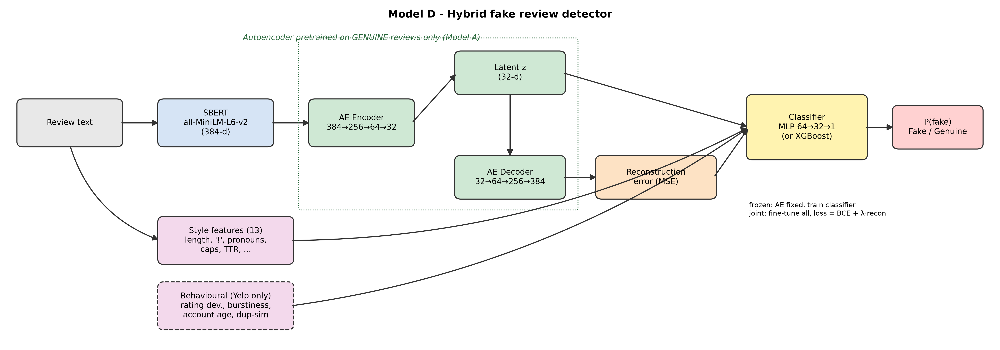

# Fake Review Detection with Autoencoders and Deep Learning

B.Tech CSE (AI & ML) major project. Two autoencoder-based detectors of fake product reviews, compared with
standard baselines, plus a proposed **hybrid** model:

1. **Anomaly detection without labels:** an autoencoder is trained **only on genuine reviews**. A fake review
   is reconstructed poorly, so a **high reconstruction error means "probably fake"**.
2. **Hybrid (proposed):** the encoder's latent vector, the reconstruction error and writing-style features
   (plus reviewer-behaviour features when Yelp data is available) feed a deep classifier.

<!-- RESULTS:START -->
## Results

TBD - filled in from `results/tables/` after the runs.
<!-- RESULTS:END -->

## Models

| ID | Model | Input | Labels for training? | File |
|---|---|---|---|---|
| - | Logistic Regression / Linear SVM / Multinomial NB | TF-IDF 1-2 grams (10k) | yes | `src/models/baselines.py` |
| - | 1D-CNN / BiLSTM | GloVe 100d sequences | yes | `src/models/cnn.py`, `bilstm.py` |
| - | DistilBERT (RoBERTa optional) | raw text | yes | `src/models/transformer.py` |
| **A** | Dense autoencoder | SBERT `all-MiniLM-L6-v2` (384-d) | **no** | `src/models/ae_dense.py` |
| **B** | LSTM seq2seq autoencoder | GloVe token sequences | **no** | `src/models/lstm_ae.py` |
| **C** | Denoising AE, Variational AE | SBERT | **no** | `src/models/ae_variants.py` |
| **D** | Hybrid: z + recon. error + style (+ behaviour) → MLP / XGBoost; frozen or joint | SBERT + style | yes | `src/models/hybrid.py` |



## Setup

Python 3.10+ (tested with 3.11 on Windows, CPU only).

```bash
python -m venv .venv
# Windows: .venv\Scripts\activate      Linux/macOS: source .venv/bin/activate
pip install -r requirements-cpu.txt      # CPU-only PyTorch (laptop). On Colab skip this: torch is preinstalled.
pip install -r requirements.txt
python -m src.download_data --glove      # Salminen + Ott + GloVe 6B 100d (public sources, ~880 MB download)
python -m pytest                         # unit tests
```

YelpChi is optional (request it from the authors, see [`data/README.md`](data/README.md)). Everything runs without it.

### Google Colab (free T4)
Open [`notebooks/colab_runner.ipynb`](notebooks/colab_runner.ipynb) in Colab. It mounts Drive, clones the repo, installs
the requirements, keeps `data/` and `checkpoints/` on Drive (so a session timeout loses nothing) and syncs
`results/` to Drive.

## How to run each phase

| Phase | What | Command |
|---|---|---|
| 1 | EDA (plots → `results/plots/eda/`) | `python -m src.eda --dataset salminen` (or `notebooks/01_eda.ipynb`) |
| 2 | Cleaning, splits, features | automatic on first use, cached in `data/processed/` |
| 3 | Baselines | `python -m src.train --model logreg --seeds 42 43 44` (also `svm nb cnn bilstm distilbert`) |
| 4 | Autoencoders A-C | `python -m src.train --model ae_dense --seeds 42 43 44` (also `lstm_ae dae vae`) |
| 4 | Hybrid D | `python -m src.train --model hybrid --seeds 42 43 44` (also `hybrid_xgb hybrid_joint`) |
| 5 | Optuna tuning | `python -m src.tune --model ae_dense --trials 25`, then train with `--tuned` |
| 6 | Ablation | `python -m src.train --model hybrid --tag no_style --set model.features.style=false` |
| 6 | All tables + plots | `python -m src.evaluate --all` |
| 6 | SHAP + LIME | `python -m src.explain` |
| 7 | Demo | `streamlit run app/streamlit_app.py` |
| 8 | Modern-LLM fakes | `python -m src.modern_fakes generate --n 200` then `python -m src.modern_fakes evaluate` |
| all | Everything in order | `bash run_all.sh` (or `bash run_all.sh --smoke` for a 15-minute CPU check) |

Useful flags for `src.train`: `--sample 500` (stratified subsample for CPU smoke tests), `--seed` / `--seeds`,
`--tag` (names a variant), `--set key=value` (override any config value), `--tuned`, `--no-cross`.

## How the pipeline stays honest and reproducible

* **One split for everything:** stratified 70/15/15 with a fixed `split_seed`, saved as review-id lists in
  `data/processed/<dataset>/splits.json`. The 3 repeated runs change only the model seed.
* **No leakage:** TF-IDF, vocabularies and scalers are fit on the training split only. Autoencoders train on
  genuine training reviews only. Thresholds for anomaly scores are picked on validation and frozen for test.
  The hybrid uses out-of-fold reconstruction errors for its genuine training rows (the AE has seen them).
* **Every number comes from a run:** each training run appends rows to `results/runs.csv` (timestamp, model,
  dataset, config hash, seed, all metrics, train time, checkpoint). All tables in `results/tables/` are generated
  from that file by `src/evaluate.py`; nothing is typed by hand. `python -m src.evaluate --all` reloads every
  checkpoint, re-scores it and checks the metrics against `runs.csv` (`results/rescored_metrics.csv`).

## Repository layout

```
configs/            default.yaml + one YAML per model (+ tuned/ from Optuna)
data/               raw/ (downloads, git-ignored) and processed/ (cache) - see data/README.md
src/                config, data_loading, preprocess, features, models/, train, evaluate, tune, explain, ...
app/                Streamlit demo
notebooks/          01_eda, 02_baselines, 03_autoencoders, colab_runner
results/            runs.csv, tables/, plots/  (committed)
checkpoints/        trained models (git-ignored; on Drive when using Colab)
report/             outline.md, viva_notes.md, slides_outline.md, figures/
tests/              pytest unit tests
```

## Demo

```bash
streamlit run app/streamlit_app.py
```
Paste a review to get P(fake) from the hybrid model, the autoencoder's reconstruction error relative to its
threshold, a verdict and LIME word highlights. Or upload a CSV with a `text` column and download the scores.

**Free deployment:** push the repo to GitHub, then on [Streamlit Community Cloud](https://share.streamlit.io) choose
`app/streamlit_app.py`, or create a Hugging Face Space (Streamlit SDK). Checkpoints are git-ignored, so commit the
two the app needs (`checkpoints/hybrid__salminen__seed42/` and `checkpoints/ae_dense__salminen__seed42/`, a few MB)
to the deployment branch, or upload them to the Space.

## Data and licences
Salminen et al. (2022) dataset (OSF/Kaggle); Ott et al. Deceptive Opinion Spam Corpus v1.4 (CC BY-NC-SA 3.0);
GloVe (PDDL). Data is downloaded from the original sources and never redistributed by this repository.
