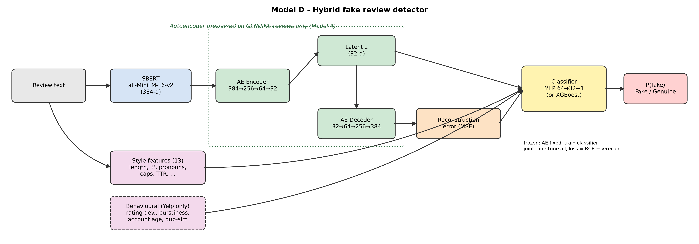

# Fake Review Detection with Autoencoders and Deep Learning

B.Tech CSE (AI & ML), 7th semester major project.

> Every number in this report is generated from `results/runs.csv` by `python -m src.evaluate`, then copied into
> this file by `python -m src.build_report` (the blocks between `<!-- TABLE:... -->` markers). Nothing is typed
> by hand. Figures are in `report/figures/`. References marked **[verify]** must be checked against the full text
> before submission.

## Abstract

Online shops depend on reviews, and fake reviews written by language models are now cheap to produce and hard for
people to spot. We study two ways of using autoencoders to detect them. (1) As an **anomaly detector**: an
autoencoder is trained only on genuine reviews, and a review it reconstructs poorly is flagged as fake. This needs
no labelled fakes. (2) As a **feature extractor in a hybrid model** (our proposed Model D): the encoder's latent
vector, the reconstruction error and simple writing-style features are combined by a supervised classifier. We
compare both against classical (TF-IDF + Logistic Regression / SVM / Naive Bayes), deep (CNN, BiLSTM on GloVe) and
transformer (DistilBERT) baselines on the Salminen et al. (2022) dataset of 40,432 Amazon reviews (half written by
GPT-2), test cross-domain transfer to the Ott et al. hotel reviews, run an ablation of the hybrid's feature groups,
explain its decisions with SHAP and LIME, and test whether the detectors catch reviews written by a modern
instruction-tuned model. The results and their interpretation are in Chapters 6-9.

## 1. Introduction

### 1.1 Problem
Customers read reviews before they buy, so fake reviews distort competition and mislead buyers. Text generators
make fakes fluent and cheap: Salminen et al. (2022) report that people detect GPT-2 generated reviews at about
chance level. Automatic detection is therefore needed.

### 1.2 Why autoencoders
Labelled fake reviews are scarce and quickly go out of date when generators change. An autoencoder trained only on
genuine reviews needs no fake examples at all: it learns what genuine reviews look like, and a high reconstruction
error signals "unlike the genuine reviews I was trained on". The same network also yields a compact latent
representation that a supervised classifier can use when labels do exist.

### 1.3 Objectives
1. Build autoencoder anomaly detectors on two input representations: sentence embeddings (Model A, dense AE;
   Model C, denoising and variational variants) and word sequences (Model B, LSTM sequence-to-sequence AE).
2. Propose a hybrid model (Model D) that combines latent features, reconstruction error and style features, and
   compare a frozen encoder with joint fine-tuning, and an MLP with XGBoost.
3. Compare everything with standard supervised baselines using F1, ROC-AUC and PR-AUC over three seeds.
4. Measure which parts of the hybrid matter (ablation), how well models transfer to another domain (Amazon → hotels),
   and whether they still catch fakes from a modern language model.
5. Explain predictions (SHAP, LIME) and deliver a demo application.

### 1.4 Contributions
- A leak-free, reproducible pipeline: one fixed split, train-only fitting of every vectoriser and scaler,
  validation-only threshold selection, out-of-fold reconstruction errors for the hybrid, every result logged.
- The hybrid Model D and its ablation.
- An honest negative-result analysis where autoencoders do not behave as the anomaly-detection assumption predicts
  (Chapter 6).
- A modern-fakes stress test and a Streamlit demo with word-level explanations.

## 2. Literature review

| Work | Approach | Relevance here |
|---|---|---|
| Jindal & Liu (2008) | First large study of opinion spam on Amazon; duplicate reviews as fakes | Problem framing |
| Ott et al. (2011, 2013) | Crowd-sourced deceptive hotel reviews; n-gram + LIWC classifiers reach about 90% accuracy | Cross-domain test set |
| Mukherjee et al. (2013) | Yelp filter labels; behavioural features beat linguistic ones on real data | Motivates behaviour features (Yelp) |
| Rayana & Akoglu (2015) | YelpChi/NYC/Zip; text + behaviour + review network | Optional Yelp data |
| Salminen et al. (2022) | GPT-2 generated Amazon reviews; humans detect them near chance, a fine-tuned RoBERTa detector does much better **[verify exact figures]** | Main dataset |
| Dong et al. (2018) | Neural autoencoder + decision forest for opinion fraud | Closest match to Model D |
| Sakurada & Yairi (2014) | Autoencoder reconstruction error for anomaly detection | Basis of Models A-C |
| LSTM autoencoder for spam reviews (unsupervised) **[verify authors/venue]** | Seq2seq AE trained on genuine reviews | Basis of Model B |
| Favuzzi, Deep-fake review detection, Politecnico di Milano thesis **[verify]** | VAE with attention on Amazon reviews | Basis of the VAE (Model C2) |
| Shahariar et al. **[verify venue/year]** | MLP/CNN/LSTM vs. NB/KNN/SVM on spam reviews | Baseline choice |
| Kim (2014); Hochreiter & Schmidhuber (1997) | Text CNN; LSTM | CNN / BiLSTM baselines |
| Reimers & Gurevych (2019); Pennington et al. (2014) | Sentence-BERT; GloVe | Input representations |
| Sanh et al. (2019) | DistilBERT | Transformer baseline |
| Vincent et al. (2008); Kingma & Welling (2014) | Denoising AE; VAE | Model C variants |

Gaps this project addresses: most autoencoder studies report a single run on one dataset without cross-domain or
generator-shift tests, and seldom separate what the autoencoder contributes from simple style cues. A data-quality
paper at RANLP 2023 **[verify]** also notes that the Amazon data behind Salminen is noisy, which we keep in mind
when interpreting very high scores.

## 3. Datasets and exploratory analysis

| Dataset | Size | Labels | Use |
|---|---|---|---|
| Salminen et al. (2022) | 40,432 Amazon reviews, 20,216 per class, 10 categories | GPT-2 generated (CG) vs. original (OR) | train / validation / test (70/15/15, stratified, fixed seed) |
| Ott et al. (2011, 2013), v1.4 | 1,600 hotel reviews, 800 per class | crowd-written deceptive vs. truthful | cross-domain test only |
| YelpChi (Rayana & Akoglu 2015) | 67,395 reviews | Yelp filter | optional, not available for this run |

Key EDA findings (`results/eda_summary.md`, figures in `report/figures/eda/`):
- Salminen fakes are shorter (median 39 vs. 47 words) and less lexically varied (type-token ratio 0.727 vs. 0.808);
  they use more first-person pronouns and fewer exclamation marks.
- **Generation artefacts:** only 35.2% of fakes end with sentence punctuation (vs. 90.6% of genuine reviews), and some
  fakes join two texts without a space. Models can learn these artefacts instead of "deceptiveness"; this is the main
  threat to validity and the reason for the cross-domain test.
- Ott reviews are about three times longer, and their style differences point in other directions (fakes use more
  exclamation marks there), so a model built on GPT-2 artefacts should not transfer.

## 4. Methodology

### 4.1 Pipeline
Raw text → cleaning (HTML, URLs, whitespace, emoji to words) → three views: lemmatised/stop-word-free text for
TF-IDF, lower-cased token sequences for GloVe models, lightly cleaned raw text for SBERT/DistilBERT → features
cached per dataset. The split (70/15/15, stratified, `split_seed=42`) is saved as review-id lists and never changes;
seeds 42/43/44 only change model initialisation and shuffling.

**Leakage rules.** TF-IDF, vocabularies and every scaler are fit on the training split only. Autoencoders see only
genuine training reviews. Anomaly thresholds are chosen on the validation split (maximum F1) and frozen for test and
for every cross-domain set; no target-domain labels are used.

### 4.2 Baselines
- TF-IDF (1-2 grams, 10k features) + Logistic Regression, linear SVM, multinomial Naive Bayes.
- 1D-CNN (filters 3/4/5) and BiLSTM (masked mean + max pooling) on trainable GloVe 100-d embeddings, 200 tokens.
- DistilBERT fine-tuned on raw text. On the CPU-only laptop it runs as `distilbert_cpu`: a stratified 2,000-review
  training subset, 128 tokens, 2 epochs, one seed. It is reported as its own row and is not comparable with a full run.

### 4.3 Autoencoder anomaly detectors (no labels)
- **Model A - dense AE** on standardised SBERT `all-MiniLM-L6-v2` embeddings (384 → 256 → 64 → z → 64 → 256 → 384),
  MSE loss, Adam, early stopping on genuine validation reconstruction error. Score = per-review MSE.
  Latent size, learning rate, dropout and batch size tuned with Optuna (validation PR-AUC).
- **Model B - LSTM seq2seq AE** on GloVe sequences (first 64 tokens): an LSTM encoder compresses the review into z,
  an LSTM decoder re-generates the tokens; score = mean token cross-entropy.
- **Model C1 - denoising AE:** Gaussian noise on the input during training. **Model C2 - VAE:** reconstruction +
  0.1·KL loss; score = reconstruction error of the mean.

### 4.4 Model D - hybrid (proposed)

Inputs: the latent vector z of a Model-A autoencoder (size from Optuna), log reconstruction error, and 13 style
features (characters, words, average word length, sentences, words per sentence, exclamation and question rates,
punctuation ratio, first-person pronoun rate, capitals ratio, ALL-CAPS word rate, type-token ratio, digit ratio).
On Yelp, 6 behavioural features (rating deviation, reviews per day, extreme-rating share, account age, review count,
near-duplicate similarity) would be added; YelpChi was not available for this run.
- **Frozen regime:** the AE is pre-trained on genuine reviews and frozen; an MLP (64-32) or XGBoost classifies.
- **Joint regime:** encoder, decoder and MLP are fine-tuned together with loss = BCE + 0.5 · reconstruction loss on
  genuine rows.
- **Out-of-fold errors:** the AE has seen the genuine training reviews, so their errors are unrealistically low. We
  train 5 extra AEs, each without one fold, to give every genuine training review an error from an AE that never
  saw it. The ablation measures whether this matters.

### 4.5 Evaluation
Precision, recall, F1, ROC-AUC, PR-AUC and confusion matrices on the fixed test split; mean ± standard deviation over
3 seeds. Plots: ROC/PR curves, reconstruction-error histograms, training curves, t-SNE/UMAP of latent spaces.
`python -m src.evaluate --all` reloads every checkpoint and re-scores it to confirm the logged numbers.

## 5. Experimental setup
- Hardware: laptop CPU (Intel i5-1145G7, 16 GB RAM), no GPU. Software: Python 3.11, PyTorch, scikit-learn,
  sentence-transformers, transformers, XGBoost, Optuna, SHAP, LIME, Streamlit (exact versions in `requirements.txt`).
- Optuna: 25 trials for Model A, 20 for Model D, TPE sampler, objective = validation PR-AUC.
- Every run: `python -m src.train --model <name> --seeds 42 43 44`; full sequence in `run_all.sh`.

## 6. Results

### 6.1 Main comparison
<!-- TABLE:main_comparison -->
TBD
<!-- /TABLE -->

<!-- DISCUSSION:main -->

Figures: `figures/roc_pr_curves.png`, `figures/confusion_matrices.png`, `figures/training_curves.png`.

### 6.2 Autoencoders
<!-- TABLE:autoencoders -->
TBD
<!-- /TABLE -->

<!-- DISCUSSION:autoencoders -->

Figures: `figures/recon_error_hist_*.png`, `figures/latent_*.png`.

## 7. Ablation of the hybrid model
<!-- TABLE:ablation -->
TBD
<!-- /TABLE -->

<!-- DISCUSSION:ablation -->

## 8. Robustness

### 8.1 Cross-domain: Amazon → hotels (Ott)
<!-- TABLE:cross_domain -->
TBD
<!-- /TABLE -->

<!-- DISCUSSION:cross_domain -->

### 8.2 Fakes from a modern language model
<!-- TABLE:modern_fakes -->
TBD
<!-- /TABLE -->

<!-- DISCUSSION:modern_fakes -->

## 9. Explainability
<!-- DISCUSSION:explain -->

Figures: `figures/explain/`.

## 10. Limitations
<!-- DISCUSSION:limitations -->

## 11. Future work
- Run the full DistilBERT/RoBERTa baselines on a GPU (Colab notebook included) and YelpChi with behavioural features.
- Train autoencoders on representations that ignore surface artefacts (e.g. punctuation-normalised text), and test on
  fakes from several modern generators rather than one.
- Contrastive or one-class objectives (Deep SVDD) instead of reconstruction error.
- A second annotator-free check: human-written deceptive reviews from other domains (restaurants, apps).

## 12. Demo
`streamlit run app/streamlit_app.py`: paste a review → P(fake) from the hybrid model, the autoencoder's
reconstruction error against its frozen threshold, a verdict and LIME word highlights; or upload a CSV with a `text`
column and download the scores.

## References
- Akiba, T., Sano, S., Yanase, T., Ohta, T., & Koyama, M. (2019). Optuna: A next-generation hyperparameter optimization framework. KDD.
- Chen, T., & Guestrin, C. (2016). XGBoost: A scalable tree boosting system. KDD.
- Dong, M., Yao, L., Wang, X., Benatallah, B., Huang, C., & Ning, X. (2018). Opinion fraud detection via neural autoencoder decision forest. Pattern Recognition Letters. arXiv:1805.03379. **[verify volume/pages]**
- Hinton, G. E., & Salakhutdinov, R. R. (2006). Reducing the dimensionality of data with neural networks. Science, 313(5786).
- Hochreiter, S., & Schmidhuber, J. (1997). Long short-term memory. Neural Computation, 9(8).
- Jindal, N., & Liu, B. (2008). Opinion spam and analysis. WSDM.
- Kim, Y. (2014). Convolutional neural networks for sentence classification. EMNLP.
- Kingma, D. P., & Welling, M. (2014). Auto-encoding variational Bayes. ICLR.
- Lin, T.-Y., Goyal, P., Girshick, R., He, K., & Dollár, P. (2017). Focal loss for dense object detection. ICCV.
- Lundberg, S. M., & Lee, S.-I. (2017). A unified approach to interpreting model predictions. NeurIPS.
- McInnes, L., Healy, J., & Melville, J. (2018). UMAP: Uniform manifold approximation and projection for dimension reduction. arXiv:1802.03426.
- Mukherjee, A., Venkataraman, V., Liu, B., & Glance, N. (2013). What Yelp fake review filter might be doing? ICWSM.
- Ott, M., Choi, Y., Cardie, C., & Hancock, J. T. (2011). Finding deceptive opinion spam by any stretch of the imagination. ACL-HLT.
- Ott, M., Cardie, C., & Hancock, J. T. (2013). Negative deceptive opinion spam. NAACL-HLT.
- Pennington, J., Socher, R., & Manning, C. D. (2014). GloVe: Global vectors for word representation. EMNLP.
- Qwen Team (2024). Qwen2.5 technical report. arXiv:2412.15115. **[verify]**
- Radford, A., Wu, J., Child, R., Luan, D., Amodei, D., & Sutskever, I. (2019). Language models are unsupervised multitask learners. OpenAI technical report.
- Rayana, S., & Akoglu, L. (2015). Collective opinion spam detection: Bridging review networks and metadata. KDD.
- Reimers, N., & Gurevych, I. (2019). Sentence-BERT: Sentence embeddings using Siamese BERT-networks. EMNLP-IJCNLP.
- Ribeiro, M. T., Singh, S., & Guestrin, C. (2016). "Why should I trust you?": Explaining the predictions of any classifier. KDD.
- Sakurada, M., & Yairi, T. (2014). Anomaly detection using autoencoders with nonlinear dimensionality reduction. MLSDA workshop. **[verify]**
- Salminen, J., Kandpal, C., Kamel, A. M., Jung, S.-G., & Jansen, B. J. (2022). Creating and detecting fake reviews of online products. Journal of Retailing and Consumer Services, 64, 102771.
- Sanh, V., Debut, L., Chaumond, J., & Wolf, T. (2019). DistilBERT, a distilled version of BERT. arXiv:1910.01108.
- Shahariar, G. M., et al. Spam review detection using deep learning. arXiv:2211.01675. **[verify authors/venue/year]**
- Vincent, P., Larochelle, H., Bengio, Y., & Manzagol, P.-A. (2008). Extracting and composing robust features with denoising autoencoders. ICML.
- LSTM autoencoder for unsupervised spam review detection. **[verify: authors, venue, year]**
- Favuzzi. Deep-fake review detection. MSc thesis, Politecnico di Milano. **[verify: full name, year]**
- RANLP 2023 paper on the quality of Amazon fake-review data. **[verify: authors, title]**
